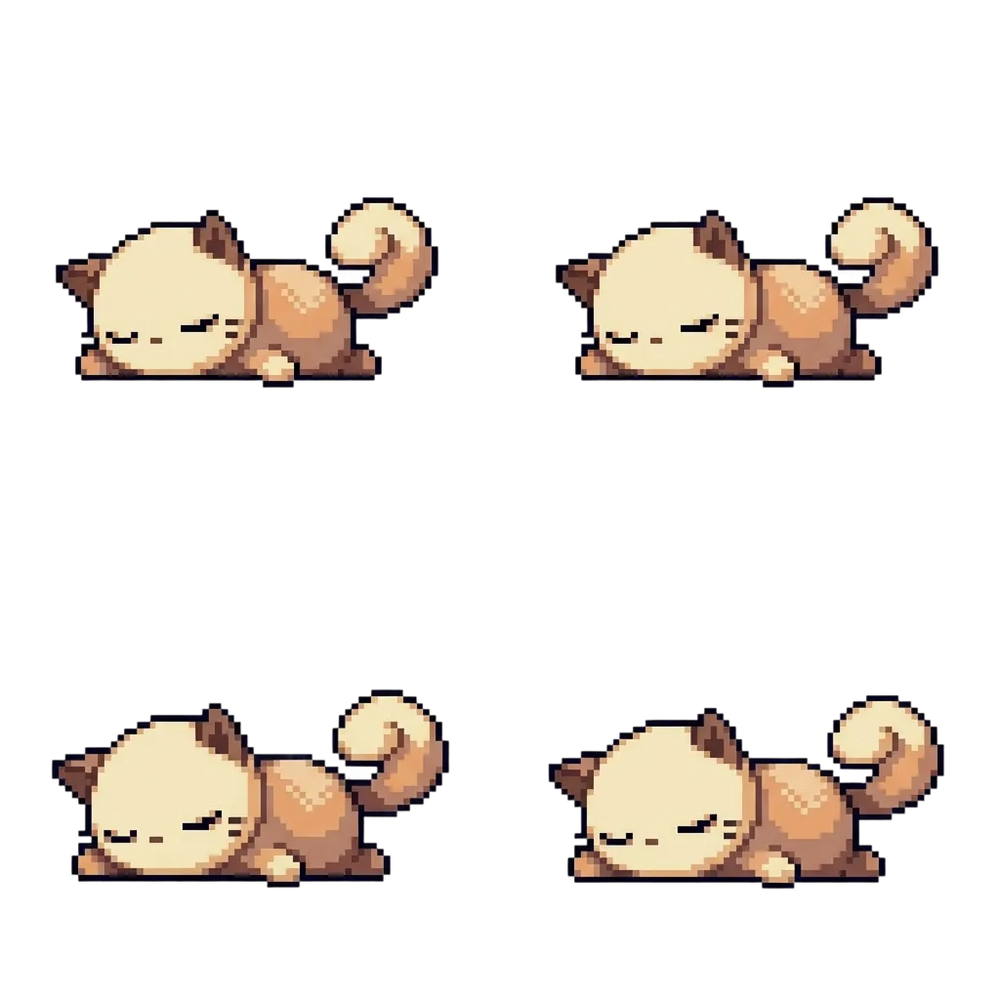

# 🐱 SleepyCat

Милый десктоп-питомец для Windows и macOS. Котик спит на вашем рабочем столе и напоминает, когда пора отдохнуть!



## 📥 Скачать

| Платформа | Ссылка |
|-----------|--------|
| **Windows** | [SleepyCat Setup.exe](https://github.com/safy/catcat/releases/latest/download/SleepyCat.Setup.1.2.0.exe) |
| **macOS** | [SleepyCat.dmg](https://github.com/safy/catcat/releases/latest/download/SleepyCat-1.2.0.dmg) |

Или перейдите на страницу [Releases](https://github.com/safy/catcat/releases) для выбора версии.

## ✨ Возможности

- 🪟 Прозрачное окно без рамки, всегда поверх других окон
- 😴 Анимированный спящий котик с пиксельной графикой
- ⏱️ Встроенный таймер (1, 5, 10, 25 минут или свой)
- 🙆 Анимация пробуждения: котик потягивается и садится
- � Сспециальная анимация питья воды
- 🔔 Звуковое уведомление (мяуканье)
- 💬 Кастомные сообщения и действия
- 🎨 Пиксельный шрифт для сообщений

## 🎮 Как пользоваться

1. **Запустите приложение** — котик появится на экране и будет спать
2. **Двойной клик на котике** — откроется меню с таймерами
3. **Выберите время** — например, "Таймер 25 минут (Pomodoro)"
4. **Работайте** — котик спит, пока идёт таймер
5. **Когда время вышло** — котик потянется, сядет (или попьёт воды) и напомнит отдохнуть!
6. **Сбросить таймер** — котик снова уснёт

## 📋 Меню (двойной клик)

- ⏱️ Таймер 1 минута
- ⏱️ Таймер 5 минут
- ⏱️ Таймер 10 минут
- ⏱️ Таймер 25 минут (Pomodoro)
- ⚙️ Свой таймер... (время + действие + сообщение)
- 🔄 Сбросить таймер
- ❌ Закрыть

## ⚙️ Свой таймер

В окне настроек можно выбрать:
- **Время** в минутах
- **Действие**: 💧 Попить воды, 🧘 Размяться, 🪟 Посмотреть в окно, ☕ Перерыв
- **Своё сообщение**

При выборе "Попить воды" котик покажет специальную анимацию!

## 🖥️ Системные требования

- **Windows** 10 или новее
- **macOS** 11 (Big Sur) или новее

## 🍎 Установка на macOS

При первом запуске macOS может показать сообщение "Приложение повреждено". Это происходит потому, что приложение не подписано сертификатом Apple Developer.

**Чтобы запустить:**

1. Откройте **Терминал**
2. Выполните команду:
   ```bash
   xattr -cr /Applications/SleepyCat.app
   ```
3. Теперь приложение запустится нормально

Или через Системные настройки:
1. Откройте **Системные настройки** → **Конфиденциальность и безопасность**
2. Найдите сообщение о заблокированном SleepyCat
3. Нажмите **"Всё равно открыть"**

## 🛠️ Для разработчиков

### Установка и запуск

```bash
# Клонировать репозиторий
git clone https://github.com/safy/catcat.git
cd catcat

# Установить зависимости
npm install

# Запустить в режиме разработки
npm start
```

### Сборка дистрибутива

```bash
npm run dist
```

Готовые установщики появятся в папке `dist/`.

## 📁 Структура проекта

```
├── main.js          # Главный процесс Electron
├── preload.js       # Preload скрипт для IPC
├── index.html       # HTML разметка
├── style.css        # Стили и анимации спрайтов
├── cat.js           # Логика поведения котика
├── settings.html    # Окно настроек таймера
├── assets/          # Спрайты анимаций
│   ├── sleep.png    # Спящий котик (4 кадра)
│   ├── Stretch.png  # Потягивается (4 кадра)
│   ├── Sit.png      # Сидит (4 кадра)
│   └── milk.png     # Пьёт воду (6 кадров)
├── fonts/           # Шрифты
│   └── Min.woff2    # Пиксельный шрифт
├── fx/              # Звуки
│   └── cat.wav      # Мяуканье
└── package.json     # Конфигурация проекта
```

## 🎨 Технологии

- Electron
- Vanilla JavaScript
- CSS Sprite Animation
- electron-builder

## 📄 Лицензия

MIT

---

Сделано с ❤️ для продуктивной работы и отдыха
